# HelCLI theme gallery

Every theme here is built into HelCLI. Themes added here later show up in the app too,
under "New in the online gallery", without updating the app.

## Using a theme

```
theme -list              show every theme
theme -preview dracula   see it before applying it
theme -apply dracula     use it
theme -old               go back to the theme you had before
```

## Sharing your own

```
theme -export mytheme    save your current colors as a theme
theme -share mytheme     send the file to another app
theme -import            pick a theme file someone sent you
theme -import https://example.com/theme.json
```

To add a theme to this gallery, put its `.json` file in this folder, run
`python3 themes/tools/build_gallery.py` to make its preview, and open a pull request.
The [theme file format](#theme-file-format) is described at the end of this page.

## Themes

### Abyss

`theme -apply abyss` · by HelCLI

Bioluminescent teal and blue from the deep sea

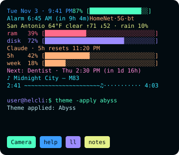

### Amber CRT

`theme -apply amber` · by HelCLI

Warm monochrome, like an old amber monitor

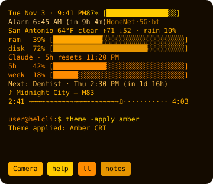

### Aurora

`theme -apply aurora` · by HelCLI

Northern lights: green, teal and violet over a dark sky

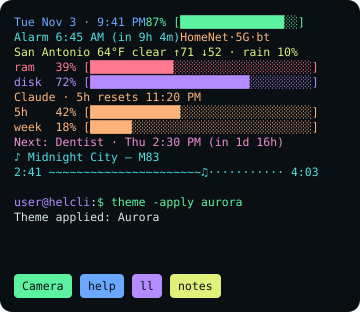

### Ayu Mirage

`theme -apply ayu-mirage` · by after Ayu

Bright, warm accents on slate blue

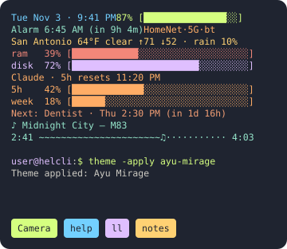

### Blue

`theme -apply blue` · by HelCLI

Deep navy with bright sky-blue text

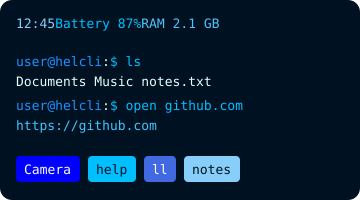

### Black & White

`theme -apply bw` · by HelCLI

Pure black and white, nothing else

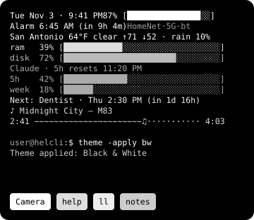

### Catppuccin Latte

`theme -apply catppuccin-latte` · by after Catppuccin

The light flavor of Catppuccin

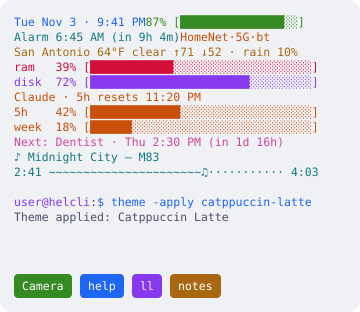

### Catppuccin Mocha

`theme -apply catppuccin-mocha` · by HelCLI

Soothing pastels on a deep mocha base

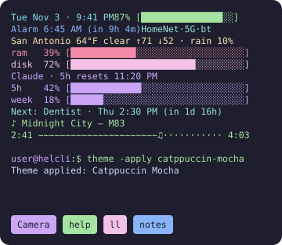

### Classic

`theme -apply classic` · by HelCLI

The original look: green prompt, white text, orange device name

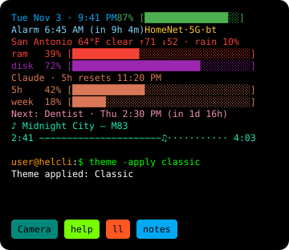

### Cotton Candy

`theme -apply cotton-candy` · by HelCLI

A treat: pink, blue and grape on spun sugar

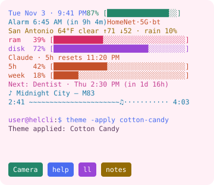

### Cyberpunk

`theme -apply cyberpunk` · by HelCLI

Neon yellow, cyan and red on a dark violet night

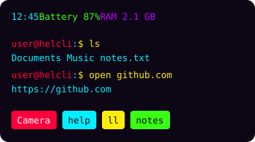

### Deep Space

`theme -apply deep-space` · by HelCLI

Starlight white and nebula colors on true black

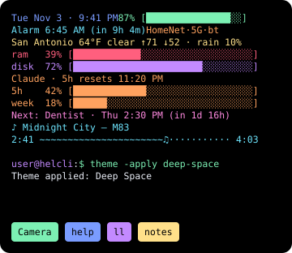

### Dracula

`theme -apply dracula` · by HelCLI

The dark purple palette loved by coders

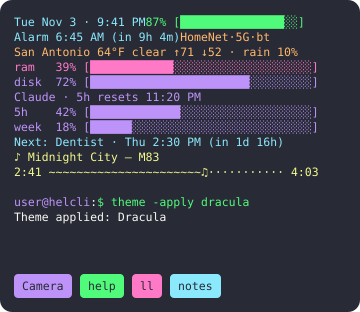

### Ember

`theme -apply ember` · by HelCLI

Glowing coals: orange, red and gold on charcoal

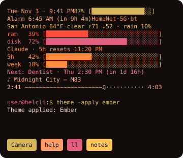

### Espresso

`theme -apply espresso` · by HelCLI

Coffee browns and cream, with a little caramel

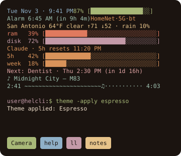

### Everforest

`theme -apply everforest` · by after Everforest

Soft greens and earth tones, easy on the eyes

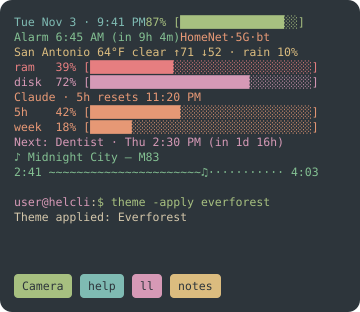

### Forest

`theme -apply forest` · by HelCLI

Moss green and bark brown, calm and earthy

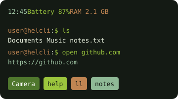

### Graphite

`theme -apply graphite` · by HelCLI

Shades of gray with one mint accent

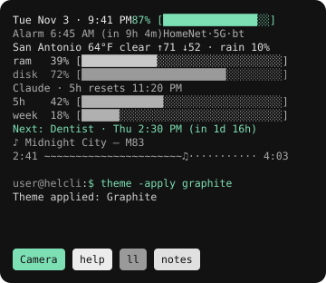

### Green

`theme -apply green` · by HelCLI

Hacker green on near-black

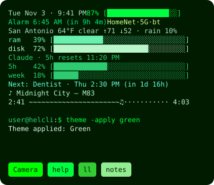

### Gruvbox

`theme -apply gruvbox` · by HelCLI

Retro, warm and easy on the eyes

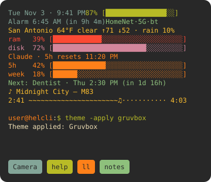

### High Contrast

`theme -apply high-contrast` · by HelCLI

Maximum readability: white and yellow on black

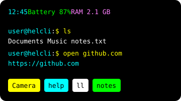

### Kanagawa

`theme -apply kanagawa` · by after Kanagawa

Ink and woodblock colors from The Great Wave

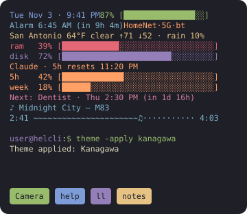

### Lemonade

`theme -apply lemonade` · by HelCLI

Fresh squeezed: citrus colors on pale yellow

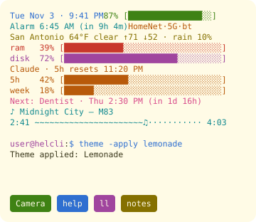

### Midnight Ink

`theme -apply midnight` · by HelCLI

Ink blue and silver on near-black

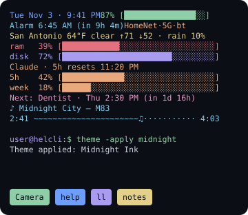

### Mint Chip

`theme -apply mint-chip` · by HelCLI

Mint ice cream with chocolate chips

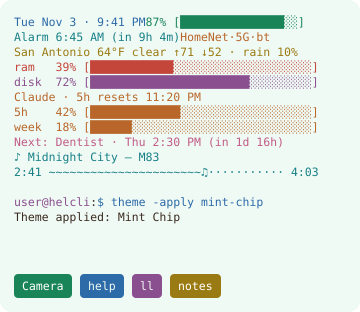

### Monokai

`theme -apply monokai` · by HelCLI

Bright pink, green and orange on charcoal

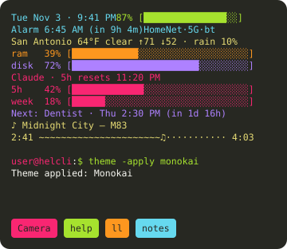

### Night Owl

`theme -apply night-owl` · by after Night Owl

Made for coding late at night

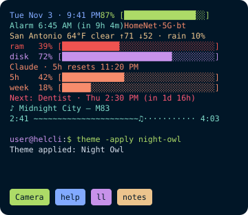

### Nord

`theme -apply nord` · by HelCLI

Cool arctic blues and soft frost

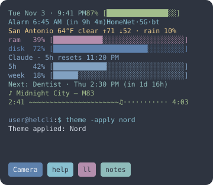

### Obsidian

`theme -apply obsidian` · by HelCLI

Volcanic glass: violet and lilac on black

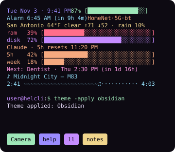

### Ocean

`theme -apply ocean` · by HelCLI

Deep sea blue with teal and coral

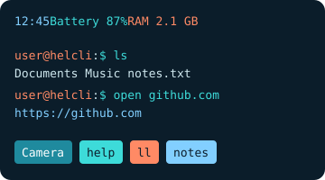

### OLED Black

`theme -apply oled` · by HelCLI

True black to save battery, with gentle gray text

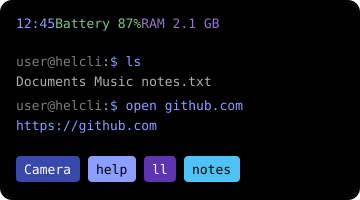

### One Dark

`theme -apply one-dark` · by after Atom One Dark

The classic editor dark theme

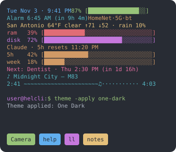

### Paper

`theme -apply paper` · by HelCLI

Dark ink on warm paper, for daylight

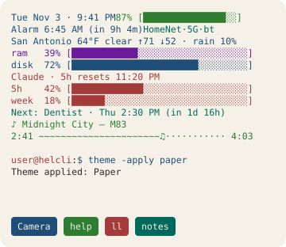

### Green Phosphor

`theme -apply phosphor` · by HelCLI

Glowing green on black, like an 80s terminal

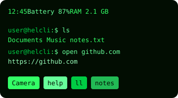

### Pink

`theme -apply pink` · by HelCLI

Plum background with candy-pink text

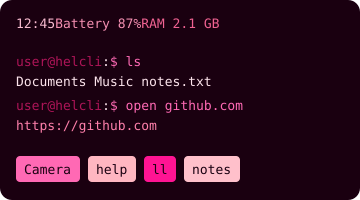

### Red

`theme -apply red` · by HelCLI

Dark crimson with hot orange-red text

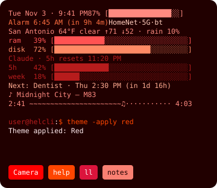

### Rosé Pine Dawn

`theme -apply rose-pine-dawn` · by after Rosé Pine

Rosé Pine for the morning: warm paper and soft ink

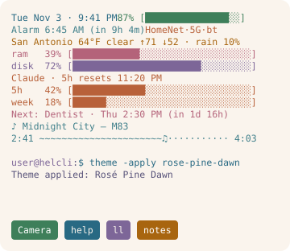

### Rosé Pine

`theme -apply rose-pine` · by after Rosé Pine

Soho vibes: muted pine, rose and gold on deep purple

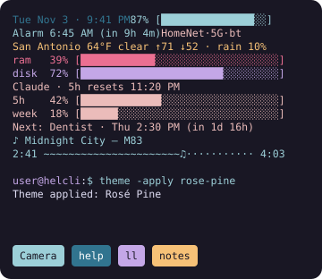

### Sakura

`theme -apply sakura` · by HelCLI

Cherry blossom pink on soft night blue

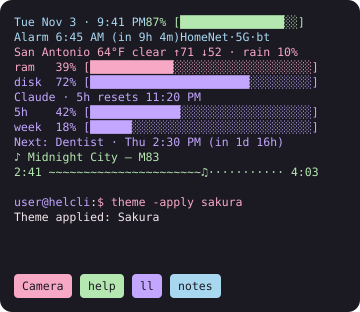

### Solarized Dark

`theme -apply solarized-dark` · by HelCLI

The classic low-contrast palette, dark version

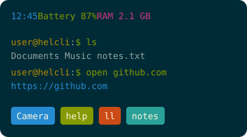

### Solarized Light

`theme -apply solarized-light` · by HelCLI

The classic low-contrast palette, light version

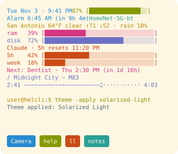

### Tokyo Night

`theme -apply tokyo-night` · by HelCLI

City lights at night: soft blue and purple

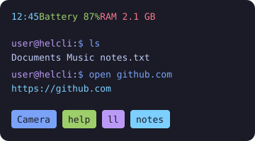

### Vaporwave

`theme -apply vaporwave` · by HelCLI

Pink and cyan neon on a purple sunset

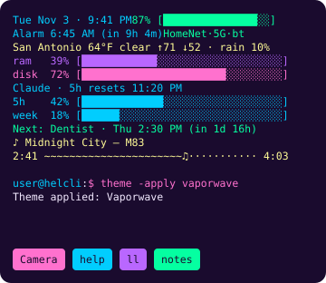

## Theme file format

A theme is a JSON file. `theme` holds colors from `theme.xml` and `suggestions` holds colors
from `suggestions.xml`. Colors are `#RRGGBB` or `#AARRGGBB` (`AA` is opacity: `ff` is solid,
`00` is invisible). Any color you leave out goes back to its default when the theme is applied.

```json
{
  "name": "mytheme",
  "title": "My Theme",
  "author": "you",
  "description": "One line about how it looks",
  "theme": {
    "bg_color": "#ff101010",
    "overlay_color": "#b0101010",
    "input_color": "#ff00ff00",
    "output_color": "#ffffffff",
    "device_color": "#ffff9800"
  },
  "suggestions": {
    "apps_bg_color": "#ff00897b",
    "default_text_color": "#ff000000"
  }
}
```

`overlay_color` is drawn over your wallpaper when `system_wallpaper` is on.

Colors a theme can set:

- **theme**: `input_color`, `output_color`, `bg_color`, `device_color`, `battery_color_high`, `battery_color_medium`, `battery_color_low`, `time_color`, `storage_color`, `ram_color`, `network_info_color`, `toolbar_bg`, `toolbar_color`, `enter_color`, `cursor_color`, `overlay_color`, `alias_content_color`, `statusbar_color`, `navigationbar_color`, `app_installed_color`, `app_uninstalled_color`, `hint_color`, `mark_color`, `notes_color`, `notes_locked_color`, `link_color`, `restart_message_color`, `weather_color`, `unlock_counter_color`, `session_info_color`, `status_lines_bgrectcolor`, `input_bgrectcolor`, `output_bgrectcolor`, `toolbar_bgrectcolor`, `suggestions_bgrectcolor`, `status_lines_bg`, `input_bg`, `output_bg`, `suggestions_bg`, `status_lines_shadow_color`, `input_shadow_color`, `output_shadow_color`, `claude_color`, `alarm_color`, `music_color`, `calendar_color`
- **suggestions**: `default_text_color`, `default_bg_color`, `apps_text_color`, `apps_bg_color`, `alias_text_color`, `alias_bg_color`, `cmd_text_color`, `cmd_bg_color`, `song_text_color`, `song_bg_color`, `contact_text_color`, `contact_bg_color`, `file_text_color`, `file_bg_color`
